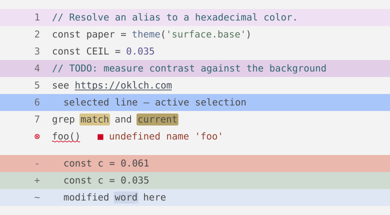
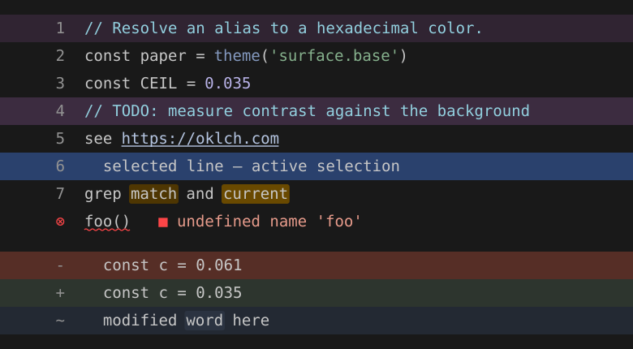

# Themes

| TE calm | TE dark |
| --- | --- |
|  |  |
| [`te-calm.tokens.json`](te-calm.tokens.json): Teenage Engineering-inspired, gray backgrounds, high chroma for error marks | [`te-dark.tokens.json`](te-dark.tokens.json): dark twin of TE calm, off-black backgrounds, the same roles and saturation order |

The tools follow the system light/dark mode: te-calm is the light theme and te-dark the dark theme.
`appearance-themes` in [`generate.clj`](generate.clj) names this pair.
The generator writes a `baked-light` and a `baked-dark` file for each tool. Each theme also has its own `preview-<name>.svg`.

| Tool | How it switches |
| --- | --- |
| Rex | Settings > Theme has a light and a dark slot. Import `~/.config/rex/themes/baked-light` and `baked-dark` once, and assign them. |
| Neovim | Neovim sets `background` from the terminal. [`colors/baked.lua`](../packages/nvim/.config/nvim/colors/baked.lua) reloads the highlights for the new value. |
| Helix | [`follow-appearance.sh`](../packages/helix/.config/helix/follow-appearance.sh) links `baked.toml` to the matching file and makes open Helix windows reload. `install.sh` runs the script once. On macOS, it also loads a launchd agent that runs the script when the system preferences change. |

## Structure

Each `*.tokens.json` file defines the colors as [design tokens](https://tr.designtokens.org/) in two layers:

- **Primitives:** OKLCH color scales.
- **Semantic tokens:** named roles that refer to primitives, such as `syntax.string`, `diff.add`, and `status.error`.

All theme files define the same semantic tokens. Each file describes its own values, so you can read one theme without the other.

### Token groups

| Group | Kind | Use it for |
| --- | --- | --- |
| `surface` | background | Editor, bar, popup, and current-line backgrounds; the active-tab keycap |
| `border` | foreground | Separators, borders, and indent guides |
| `text` | foreground | Interface and body text; `text.accent` for interface elements that need a color |
| `syntax` | foreground | Code only. Interface elements never use these |
| `status` | foreground | Diagnostics, Git signs, and success or failure states |
| `signal` | foreground | Small attention marks: unsaved buffer, macro recording |
| `selection` | background | Selections, the selected entry in menus and lists, matching brackets and references |
| `search` | background | Search matches and jump labels |
| `comment`, `doc` | mixed | Code comments, documentation, and Markdown |
| `diff` | background | Added, changed, and deleted lines and words |
| `cursor` | background | Cursor blocks |
| `mode` | background | The mode keycap in the status line |
| `terminal` | foreground | The 16 ANSI colors |

Most groups contain only foregrounds or only backgrounds.
In the mixed groups, `fg` and `bg` name the main pair, and other backgrounds end in `Bg`, such as `doc.quoteBg`.

Tools do not read the tokens directly. Each generator converts semantic tokens to the format for its tool:

| Tool | Generator |
| --- | --- |
| Neovim | [`generators/nvim.clj`](generators/nvim.clj) |
| Helix | [`generators/helix.clj`](generators/helix.clj) |
| Rex | [`generators/rex.clj`](generators/rex.clj) |

`adapters` in [`generate.clj`](generate.clj) lists the output path of each generated file.

The generator uses the names `baked-light` and `baked-dark` for each output file and its theme name.
The names do not depend on the themes in `appearance-themes`.
Thus, the tool configuration does not change when you change the pair.

Git ignores the generated files (`packages/**/baked*`). `install.sh` regenerates them on each run.
The generator also creates one `preview-<name>.svg` for each theme. Git tracks these files so GitHub can display them.
Do not edit generated files manually.

The Claude Code status line, Starship, and Git output use named ANSI colors from the terminal palette.
They use the terminal colors and do not need separate generated files.

### Source files

- [`engine.clj`](engine.clj) resolves token references into the `theme` function, for example `(theme "surface.base")`.
  It also validates the contract between tokens and generators.
- [`generators/`](generators/) contains one namespace for each tool. Each provides a `render` function.
  `preview.clj` is separate from `adapters` so preview-only references do not hide tokens that no tool generator references.
- [`generate.clj`](generate.clj) registers tool generators in `adapters`, selects the theme, validates the contract, and writes all output files.

## Change the theme

Edit a token file.
Then run these commands from the repository root:

```sh
# Install Babashka. Do this one time.
mise install

# Generate the light and dark files for all tools. install.sh also runs this command.
(cd theme && bb -m generate)

# Show a 24-bit color preview in the terminal. This does not write files.
(cd theme && bb -m generate --preview)                  # Preview the light theme.
(cd theme && bb -m generate --preview --theme te-dark)  # Preview another theme.

# Generate the files. Then validate the token references and output for all themes.
(cd theme && bb -m generate && bb test)
```

Reload each tool to apply the new colors. In Neovim, run `:BakedReload`.
In Rex, import `~/.config/rex/themes/baked-light` and `baked-dark` again in Settings > Theme > Import.

The terminal preview and the `preview-<name>.svg` images use the same sample definition.
Use `--preview` through SSH or in a Neovim `:terminal` window.
Examine the changes before you reload the tools.
Use a terminal with 24-bit color support, such as Rex, kitty, or a recent tmux version.
The error mark uses a curved underline in terminals that support it, such as kitty, and a straight underline elsewhere.

## Add a tool

1. Create `generators/<tool>.clj` with a `render` function. `generate.clj` calls it with the theme and the tool's theme name, `baked-light` or `baked-dark`.
2. Add the generator and its output path to `adapters` in `generate.clj`. Start the file name with `baked`, so Git ignores it, and put `%s` where `light` or `dark` goes.
3. Run the generation and test commands above.

No changes to `engine.clj` are needed.
The contract test finds missing token references and tokens that no generator references.
